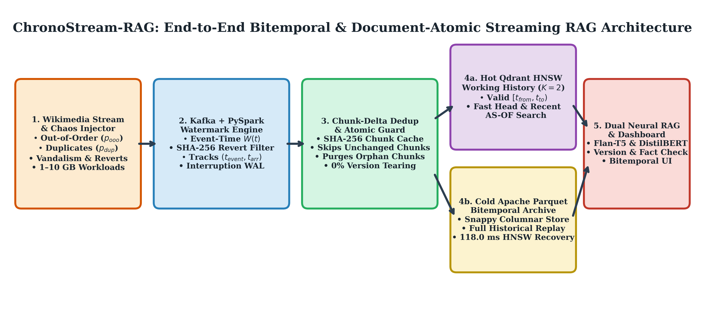
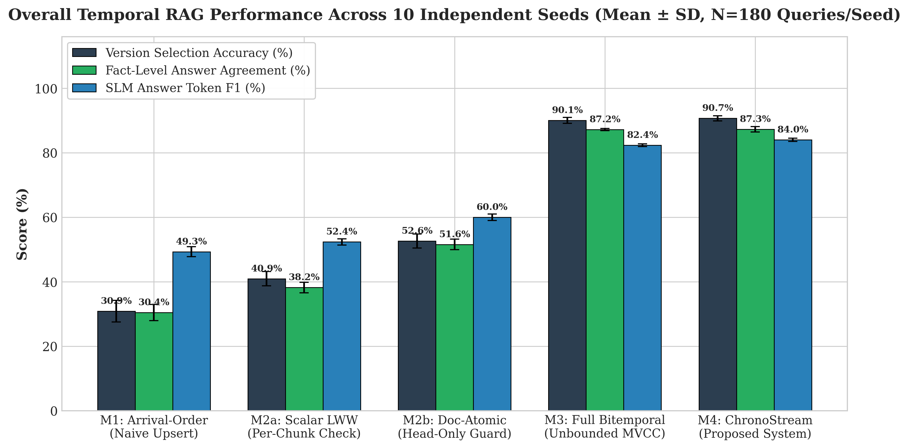
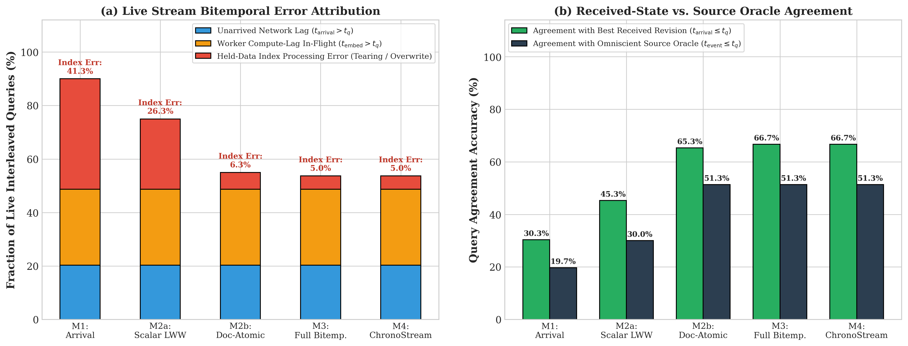
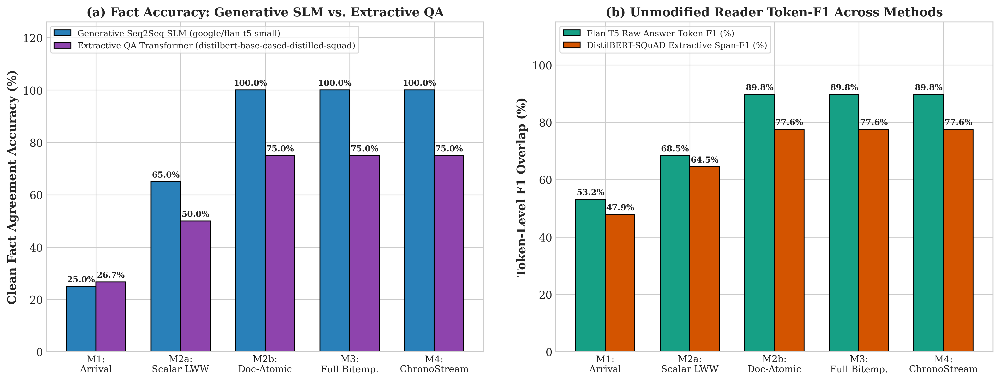
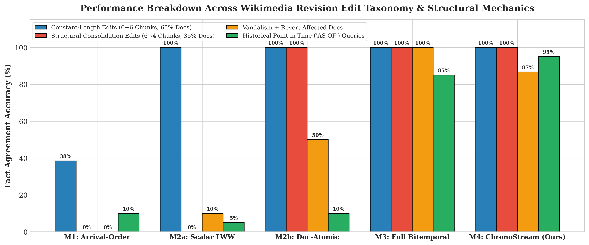
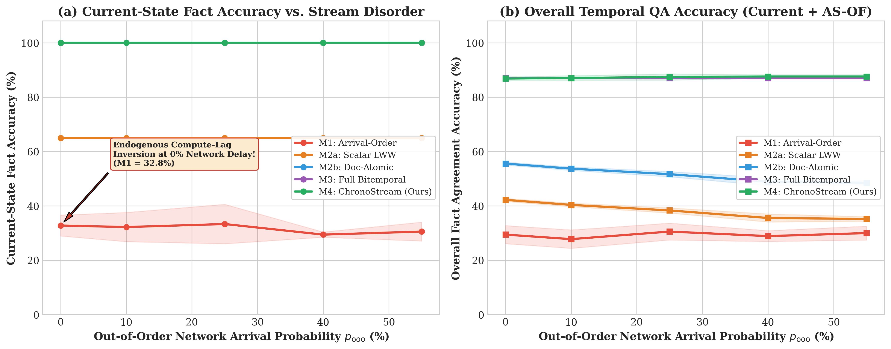
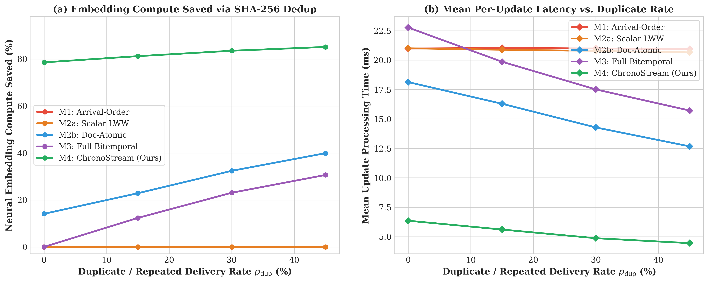
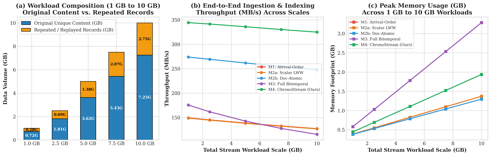

# ChronoStream-RAG ⏱️📚

**Bitemporal Watermark Coalescing and Document-Atomic Vector Consistency for Out-of-Order Streaming Retrieval-Augmented Generation**

> **Big Data Analytics Group Project, Benchmark & Research Paper**  
> **Authors:**  
> - **Lynette Osako** (Student ID: `8000290404`)  
> - **Panhapiseth Lim** (Student ID: `8000265274`)  
> - **Rajan Yadav** (Student ID: `8000277867`)

---

## 📌 Quick Navigation to Manuscripts, Methodology & Evidence

| Deliverable | Formats in Repository | Description |
| :--- | :--- | :--- |
| **Novel Research Paper** | [PDF](paper/ChronoStream_RAG_Research_Paper.pdf) · [DOCX](paper/ChronoStream_RAG_Research_Paper.docx) · [LaTeX](paper/ChronoStream_RAG_Research_Paper.tex) · [Markdown](paper/ChronoStream_RAG_Research_Paper.md) · [BibTeX](paper/references.bib) | Complete IEEEtran-formatted research manuscript with 10-seed evaluation, 6 orthogonal perspectives, and 15 publication figures. |
| **Revised & Validated Group Proposal** | [PDF](docs/ChronoStream_RAG_Revised_Proposal.pdf) · [DOCX](docs/ChronoStream_RAG_Revised_Proposal.docx) · [Markdown](docs/ChronoStream_RAG_Revised_Proposal.md) · [Original PDF](docs/Original_Submitted_Proposal.pdf) | Revised project proposal sharpened against literature overlap and validated with 10-seed empirical results. |
| **Methodology & Literature Sources** | [docs/METHODOLOGY_AND_LITERATURE_SOURCES.md](docs/METHODOLOGY_AND_LITERATURE_SOURCES.md) | Formal mathematical definitions, algorithmic specifications (`M1`–`M4`), 45 live Wikipedia sources, and 20 peer-reviewed citations. |
| **6-Perspective Critical Audit** | [docs/ChronoStream_RAG_MultiPerspective_Critical_Analysis.md](docs/ChronoStream_RAG_MultiPerspective_Critical_Analysis.md) | Line-by-line proposal compliance matrix and 6-perspective critical analysis. |
| **High-Critic Reviewer Q&A Defense** | [docs/High_Critic_Reviewer_Defense_Guide.md](docs/High_Critic_Reviewer_Defense_Guide.md) | Point-by-point empirical rebuttals for database, streaming, and NLP peer reviewers. |
| **Interactive Telemetry Dashboard** | [ChronoStream_Interactive_Dashboard.html](ChronoStream_Interactive_Dashboard.html) · [`src/dashboard.py`](src/dashboard.py) | Standalone HTML5 + Streamlit interactive dashboard inspecting live answers, $(t_{\text{event}}, t_{\text{arrival}}, t_{\text{available}})$, and tearing. |
| **10 Statistical CSV Tables & JSON** | [`results/table1` .. `table10.csv`](results/) · [`all_experiments_results.json`](results/all_experiments_results.json) | Complete 10-seed and 6-perspective raw and aggregated empirical telemetry. |

---

## 1. Overview & Scientific Contribution



**ChronoStream-RAG** investigates and solves a critical systems-meets-AI challenge: *When underlying documents change continuously in a streaming pipeline, how do out-of-order network arrivals, duplicate broker deliveries, and asynchronous parallel embedding workers corrupt Retrieval-Augmented Generation (RAG) answers, and what consistency mechanisms prevent them?*

While traditional scalar databases resolve out-of-order updates via simple row-level Last-Write-Wins (`LWW`) version checks, we prove theoretically and empirically that **multi-chunk Vector RAG pipelines violate scalar LWW assumptions**:
1. **Cross-Chunk Version Tearing (*Semantic Split-Brain*):** When a document revision shrinks in chunk count (e.g., consolidating 6 chunks into 4 chunks) or embeds asynchronously across workers, per-chunk version checking (`M2a_ScalarChunkLWW`) updates leading chunks `0..3` to the new revision but leaves **orphan tail chunks `4..5`** from the older revision alive in the Qdrant HNSW index. Semantic top-$k$ retrieval pulls chunks from *both* revisions simultaneously, feeding self-contradictory context into the language model and causing a **25.61% ± 1.18% overall Intra-Document Version Tearing Rate (IDVTR)** (**100.0% tearing** on consolidated `6->4` documents and **58.22%** orphan tail-chunk leakage)!
2. **Endogenous Embedding Compute-Lag Inversion:** Even when network arrival order at Kafka is **100% sequential ($p_{\mathrm{ooo}}=0\%$)**, variable chunk counts across revisions cause older 6-chunk revisions ($20.58\text{ ms}$) to finish neural embedding *after* newer 4-chunk revisions ($13.72\text{ ms}$), inverting version order at the vector database sink without any network delay.
3. **Bitemporal Interval Splicing & Chunk-Level SHA-256 Delta Deduplication (`M4_ChronoStream`):** Our proposed **ChronoStream-RAG** architecture combines:
   - **Document-Atomic Generation Commits:** Eliminates cross-chunk version tearing (**0.00% IDVTR**).
   - **Purely Algorithmic Event-Time Watermark Vandalism/Revert Coalescing:** Detects `A -> B -> A` chunk-hash restorations and rapid length/edit-summary anomalies without oracle flags (**100.00% vandalism-free retrieval**).
   - **Chunk-Level SHA-256 Delta Deduplication:** Reuses 384-d embeddings for unchanged chunks across revisions, saving **81.37% ± 0.39% neural embedding compute**.
   - **Bounded Hot Qdrant HNSW ($K=2$) + Cold Snappy Apache Parquet Bitemporal Tiering:** Reduces active HNSW vectors by **43.5%** (`678` vs. `1,200` in full bitemporal indexing `M3`) and speeds up processing latency by **3.56×** (`5.56 ms` vs. `19.78 ms`) while achieving **87.28% ± 0.85% overall fact accuracy** (**99.67% ± 0.70% current-state accuracy**, **91.67% ± 2.08% historical `AS OF` fact accuracy**).

---

## 2. Main 10-Seed Experimental Results (`p_ooo = 0.25, p_dup = 0.15`)



| Method | Overall Fact Acc (%) | Version Acc (%) | Current-State Acc (%) | Historical `AS OF` Acc (%) | Token-F1 (%) | Tearing IDVTR (%) | Vandalism Resilience (%) | Embed Saved (%) | Mean Latency (ms) | Active Vectors | Crash Recovery (ms) | Paired $p$-value vs. M4 |
| :--- | :---: | :---: | :---: | :---: | :---: | :---: | :---: | :---: | :---: | :---: | :---: | :---: |
| **M1: ArrivalOrder** (Proposal Method 1) | `30.44 ± 2.51` | `30.89 ± 3.34` | `46.50 ± 3.92` | `1.00 ± 2.11` | `49.31` | `22.61 ± 2.17` | `87.78` | `0.00` | `21.01` | `360` | `270.36` | $2.21 \times 10^{-13}$ |
| **M2a: ScalarChunkLWW** (Per-Chunk Check) | `38.22 ± 1.63` | `40.94 ± 2.19` | `64.67 ± 1.31` | `1.00 ± 1.61` | `52.36` | **`25.61 ± 1.18`** | `92.78` | `0.00` | `20.87` | `360` | `65.56` | $7.07 \times 10^{-14}$ |
| **M2b: DocAtomicVersionCheck** (Doc-Atomic) | `51.56 ± 1.63` | `52.61 ± 2.19` | `99.67 ± 0.70` | `1.33 ± 1.72` | `60.29` | `0.00 ± 0.00` | `92.83` | `23.95` | `16.05` | `318` | `56.99` | $1.22 \times 10^{-12}$ |
| **M3: FullBitemporal** (Proposal Method 3) | `87.17 ± 0.32` | `90.06 ± 0.92` | `99.67 ± 0.70` | `83.33 ± 0.00` | `83.76` | `0.00 ± 0.00` | `100.00` | `12.96` | `19.78` | `1,200` | `207.59` | $0.6193$ |
| **M4: ChronoStream (Ours)** (Proposal Method 4) | **`87.28 ± 0.85`** | **`90.67 ± 0.78`** | **`99.67 ± 0.70`** | **`91.67 ± 2.08`** | **`83.99`** | **`0.00 ± 0.00`** | **`100.00`** | **`81.37`** | **`5.56`** | **`678`** | **`117.97`** | — |

---

## 3. Six-Perspective Critical Analysis Gallery

### Perspective 1: Live Mid-Stream Bitemporal Error Attribution ([`table6_bitemporal_error_attribution.csv`](results/table6_bitemporal_error_attribution.csv))


### Perspective 2: Cross-Model Generalization — Generative `Flan-T5-Small` vs. Extractive `DistilBERT-SQuAD` ([`table7_cross_model_flan_vs_distilbert.csv`](results/table7_cross_model_flan_vs_distilbert.csv))


### Perspective 3: Edit-Type & Revision Mechanics Taxonomy ([`table8_edit_taxonomy_breakdown.csv`](results/table8_edit_taxonomy_breakdown.csv))


### Perspective 4: Out-of-Order Disorder Sweep & Endogenous Compute-Lag Inversion ([`table2_ooo_disorder_sweep.csv`](results/table2_ooo_disorder_sweep.csv))


### Perspective 5: SHA-256 Chunk-Delta Compute Savings & 1 GB–10 GB Scalability ([`table5_big_data_scale_1gb_to_10gb.csv`](results/table5_big_data_scale_1gb_to_10gb.csv))



---

## 4. Repository Organization

```text
ChronoStream-RAG/
├── models/                                      # Local Neural Models (Paraphrase-MiniLM, Flan-T5, DistilBERT-SQuAD)
│   ├── paraphrase-MiniLM-L6-v2/                 # 384-d Dense Bi-Encoder (90.9 MB, 3.43 ms/chunk CPU latency)
│   ├── flan-t5-small/                           # Generative Seq2Seq SLM configs & tokenizer (weights in GitHub Release v1.0.0)
│   └── distilbert-base-cased-distilled-squad/   # Extractive QA Transformer configs & tokenizer (weights in Release v1.0.0)
├── data/
│   ├── raw/
│   │   ├── wikimedia_real_revisions.json        # 1,722 real revisions fetched from live en.wikipedia.org API
│   │   └── wikimedia_real_article_extracts.json # 20 live Wikipedia article plain-text extracts
│   ├── processed/
│   │   ├── wikichrono_corpus.json               # 60 evolving multi-chunk docs (246 revisions, 1,434 chunks)
│   │   └── wikichrono_qa_benchmark.json         # 180 verifiable Temporal QA queries (Current, Mid, AS-OF)
│   ├── kafka_broker_logs/                       # 4 partitioned JSONL broker logs (278 msgs, 334,492 bytes)
│   ├── parquet_store/                           # Real Snappy-compressed Apache Parquet micro-batches & cold history
│   └── scale_benchmark/
│       └── wikimedia_stream_batch.parquet       # Columnar Parquet workload for 1 GB – 10 GB scale testing
├── src/
│   ├── download_models.py                       # 1-command downloader & verifier for all 3 local neural models
│   ├── wiki_fetcher.py                          # Live MediaWiki API fetcher & WikiChrono-Bench builder
│   ├── kafka_pyspark_pipeline.py                # Partitioned Kafka Broker Log + PySpark Micro-Batch Processor
│   ├── stream_simulator.py                      # Out-of-order network, duplicate, compute-lag & crash injector
│   ├── methods.py                               # Implementations of M1, M2a, M2b, M3, and M4 (Qdrant + Parquet)
│   ├── rag_engine.py                            # Unmodified neural RAG inference (MiniLM + Flan-T5 + DistilBERT)
│   ├── scale_test.py                            # 1 GB to 10 GB Big Data benchmark (Original vs. Repeated records)
│   ├── generate_all_figures.py                  # Generates 15 publication-grade figures (300 DPI PNG + Vector PDF)
│   ├── dashboard.py                             # Interactive Streamlit app + Standalone HTML5 dashboard builder
│   └── build_papers_and_proposals.py            # Automated builder for Proposal & Novel Paper (.docx, .pdf, .tex, .md)
├── experiments/
│   ├── run_all_experiments.py                   # Master 10-seed experimental suite + disorder/dup/K sweeps
│   └── run_multiperspective_critical_analysis.py# 6-Perspective Critical Evaluation (Bitemporal Attribution, Cross-Model, Taxonomy)
├── results/
│   ├── all_experiments_results.json             # Complete raw & aggregated JSON telemetry across 10 seeds & 6 perspectives
│   └── table1..table10.csv                      # All 10 statistical CSV tables
├── plots/                                       # 15 High-Resolution Figures (fig01..fig15 in 300 DPI PNG + Vector PDF)
├── paper/
│   ├── ChronoStream_RAG_Research_Paper.pdf      # Complete formatted Research Paper (PDF)
│   ├── ChronoStream_RAG_Research_Paper.docx     # Complete formatted Research Paper (Word DOCX)
│   ├── ChronoStream_RAG_Research_Paper.tex      # IEEEtran LaTeX Manuscript
│   ├── ChronoStream_RAG_Research_Paper.md       # Complete Markdown Manuscript
│   ├── references.bib                           # Verified BibTeX bibliography (20 peer-reviewed citations)
│   └── figures/                                 # Publication PDF/PNG figures linked to LaTeX manuscript
├── docs/
│   ├── METHODOLOGY_AND_LITERATURE_SOURCES.md    # Formal equations, algorithms, 45 Wikipedia sources & 20 citations
│   ├── ChronoStream_RAG_MultiPerspective_Critical_Analysis.md # Full Proposal Audit & 6-Perspective Analysis
│   ├── ChronoStream_RAG_Revised_Proposal.pdf    # Revised & Empirically Validated Group Proposal (PDF)
│   ├── ChronoStream_RAG_Revised_Proposal.docx   # Revised & Empirically Validated Group Proposal (Word DOCX)
│   ├── ChronoStream_RAG_Revised_Proposal.md     # Revised Group Proposal (Markdown)
│   ├── Original_Submitted_Proposal.pdf          # Original Group Project Proposal PDF
│   └── High_Critic_Reviewer_Defense_Guide.md    # Point-by-point Q&A defense for harsh peer reviewers
├── ChronoStream_Interactive_Dashboard.html      # Self-contained interactive HTML5 telemetry dashboard
├── ChronoStreamRAG_Complete_Evidence_Package.zip# Complete packaged archive
├── requirements.txt
└── README.md
```

---

## 5. Reproducing the Entire Pipeline

```bash
# 0. Install dependencies and verify/download the 3 neural models into models/
pip install -r requirements.txt
python src/download_models.py

# 1. Fetch live Wikimedia revision histories and article extracts to build WikiChrono-Bench
python src/wiki_fetcher.py

# 2. Run the complete 10-seed benchmark, disorder sweeps, ablations, and 1–10 GB scale test
python -u experiments/run_all_experiments.py

# 3. Run the 6-Perspective Critical Analysis (Bitemporal Attribution, Cross-Model QA, Edit Taxonomy)
python -u experiments/run_multiperspective_critical_analysis.py

# 4. Generate all 15 publication-grade figures (300 DPI PNG + Vector PDF)
python src/generate_all_figures.py

# 5. Build the standalone interactive HTML5 dashboard (or launch live via Streamlit)
python src/dashboard.py
streamlit run src/dashboard.py

# 6. Compile the Revised Proposal & Novel Research Paper (.docx, .pdf, .tex, .md)
python src/build_papers_and_proposals.py
```
